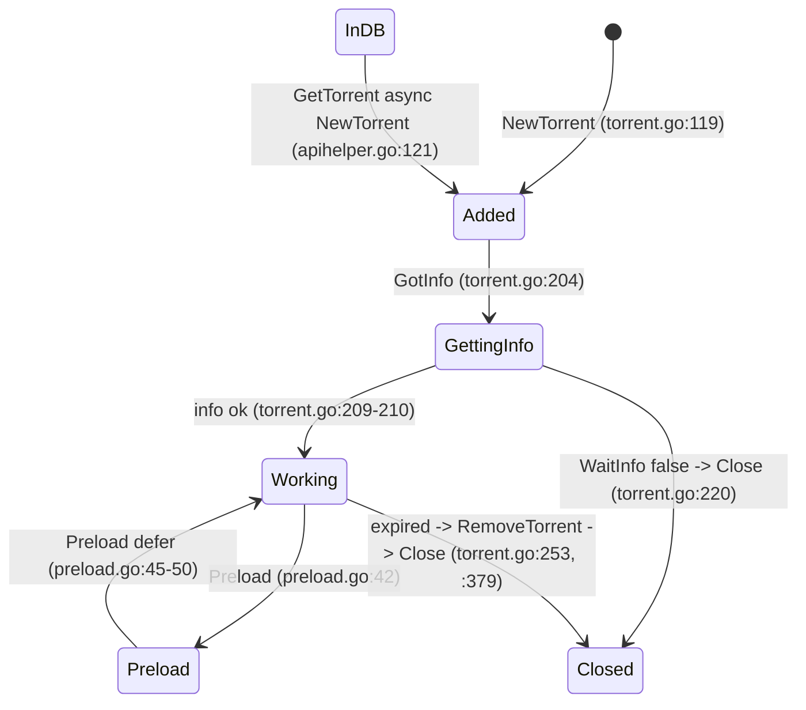

# Torrent lifecycle

**App:** server
**Status:** stable
**Last reviewed:** 2026-10-26 (commit `e2d242e0`)

## Summary
`torr.Torrent` wraps an anacrolix `*torrent.Torrent` plus TorrServer metadata and the per-torrent `torrstor.Cache`. It is registered in `BTServer.torrents` on creation, polled every second by a `watch` goroutine, and unloaded (dropped from the client and the map) when idle past its expiry time. Unloaded torrents persisted in DB are represented by DB-only copies with `Stat=TorrentInDB`. Flagged torrents (NAS predownload) also get the NAS re-added as a peer from the watch tick ([Remote download](remote-download.md)).

## Entry points
- `server/torr/torrent.go:67` — `NewTorrent`: called by `AddTorrent`, `LoadTorrent`, `GetTorrent` (see [Torrent API helpers](torrent-api-helpers.md))
- `server/torr/torrent.go:181` — `GotInfo`: called by HTTP handlers before use (`server/web/api/torrents.go:153`, `server/web/api/stream.go:155`, `server/web/api/play.go:64`, `server/torr/stream.go:48`) and by `GetTorrent`'s async load (`server/torr/apihelper.go:130`)
- `server/torr/torrent.go:248` — `progressEvent`: 1 s tick, owns timeout unload, NAS peer re-add
- `server/torr/btserver.go:63` — `Connect`: at startup (`server/web/server.go:77`) and by `SetSettings`/`SetDefSettings` via `reconnect()` (`server/torr/apihelper.go:286-301`)

## Key files
| File | Role |
|---|---|
| `server/torr/torrent.go` | `Torrent` struct, info wait, expiry, close, `Status()` |
| `server/torr/btserver.go` | `BTServer`: anacrolix client, `torrstor.Storage`, `torrents` map under `mu` |
| `server/torr/remotepeer.go`, `remotestatus.go` | NAS peer re-add and `remote_*` status — [Remote download](remote-download.md) |
| `server/torr/state/state.go` | `TorrentStat` enum + status JSON ([Torrent status JSON](../../concepts/torrent-status-json.md)) |
| `server/torr/storage/torrstor/storage.go` | Per-hash `Cache` map; `GetCache` (`:81-88`) used after info |
| `server/torr/utils/torrent.go` | Default/file trackers merged in `NewTorrent` (`GetDefTrackers` `:77`, `GetTrackerFromFile` `:58`) |
| `server/torr/utils/freemem.go` | `FreeOSMemGC` (`:12`) called on `Disconnect` (`server/torr/btserver.go:83`) |
| `server/torr/btserver_race_test.go` | `TestBTServerTorrentsConcurrentAccess` (`:12`) |
| `server/torr/gotinfo_race_test.go` | Upstream: `TestGotInfoKeepsWorkingStateUnderConcurrentRequests` (`:75`, flaky under `-race`), `TestStatusDoesNotReorderTorrentFiles` (`:112`), `TestGotInfoDoesNotReopenClosedTorrent` (`:133`), `TestStreamAnswersUnknownFile` (`:147`) |
| `server/torr/clientrace_test.go` | Nil-client / disconnect races (`:23-128`) |
| `server/torr/torrent_test.go` | `TestExpired` (`:41`) |

## Torrent struct (`server/torr/torrent.go:25-65`)
- Metadata: `Title`, `Category`, `Poster`, `Data` (`:26-29`), embedded `*torrent.TorrentSpec` (`:30`), `Stat` (`:32`), `Timestamp`, `Size` (`:33-34`).
- NAS: `RemoteDownload` mirror of the DB flag, `remotePeerAt` (`:36-40`), both under `muTorrent`.
- Embedded `*torrent.Torrent` (`:42`) — nil for DB copies and after `drop()`; `muTorrent sync.Mutex` (`:43`).
- `bt *BTServer`, `cache *torrstor.Cache` (`:45-46`) — nil for DB copies.
- Speed accounting (`:48-52`); preload `PreloadSize`, `PreloadedBytes` (`:54-55`); ffprobe `DurationSeconds`, `BitRate` (`:57-58`).
- `expiredTime` (`:60`), `closed` = `goTorrent.Closed()` (`:62`, `:122`), `progressTicker` (`:64`).

## States (`server/torr/state/state.go:24-31`)
`TorrentAdded=0`, `TorrentGettingInfo=1`, `TorrentPreload=2`, `TorrentWorking=3`, `TorrentClosed=4`, `TorrentInDB=5`. Strings at `:5-22`.

## Flow
1. **Create** `NewTorrent` (`server/torr/torrent.go:67-131`):
   - Fails if `bt == nil || bt.client == nil` (`:69-71`).
   - Rewrites `spec.Trackers` per `BTsets.RetrackersMode` 1 append / 2 clear / 3 replace (`:72-79`); appends `trackers.txt` entries (`:81-84`).
   - Missing `InfoBytes` → taken from the DB row (`:86-90`).
   - `bt.client.AddTorrentSpec(spec)` under `bt.mu.RLock`, released explicitly before `bt.mu.Lock` (`:95-104`; RWMutex not reentrant).
   - Under `bt.mu`: hash already in the map → existing `*Torrent` (`:106-110`).
   - Expiry `TorrentDisconnectTimeout` capped at 1 min (`:112-115`, `:124`); `Stat=TorrentAdded`; `Timestamp=now`; `go watch()`; stored in map (`:117-129`). No NAS hook here.
2. **Info** `WaitInfo` (`:133-179`): takes `t.Torrent` once under `muTorrent` (survives a concurrent `drop()`, `:137-145`); waits `GotInfo()`, `closed`, or timer `1 min + TorrentDisconnectTimeout` (`:148`). On info: fills missing `InfoBytes` (`:152-154`), snapshots `bt.storage` under `bt.mu.RLock` (`:160-162`), `GetCache` (nil → torrent dropped while waiting → false, `:164-168`), `cache.SetTorrent` (`:169-170`). Cache itself is created by anacrolix calling `Storage.OpenTorrent` (`server/torr/storage/torrstor/storage.go:27-45`).
3. **GotInfo** (`:181-223`), under `muTorrent`: `Closed` → false; `Preload` → true; `Working` with info → extend expiry, true, **no state flip** (`:189-203`). Else `Stat=GettingInfo`, `WaitInfo`; success → `Working` only if still `GettingInfo`, false if `Closed` meanwhile, extend expiry (`:207-218`); failure → `Close()` (`:220`).
4. **Watch** (`:234-246`): 1 s ticker; each tick `go t.progressEvent()`; exits on `closed`.
5. **progressEvent** (`:248-285`):
   - `expired()` → log `Torrent close by timeout` + `bt.RemoveTorrent` and return (`:249-255`).
   - Under `muTorrent`: speeds from `Torrent.Stats()` deltas, `PreloadedBytes = cache.GetState().Filled` (`:257-276`); snapshot `flagged := RemoteDownload` (`:277`).
   - Flagged → `readdRemotePeer()` (≤ once per 30 s, `:281-283`); then `updateRA()`: fixed 16 MB readahead via `go cache.AdjustRA` (`:287-303`).
6. **expired()** (`:305-313`): false if `cache == nil`; `Stat`/`expiredTime` read under `muTorrent`; true when `cache.Readers() == 0 && expiredTime < now && Stat ∈ {Working, Closed}`.
   - Expiry extended by `AddExpiredTime` (`:225-232`, only forward) from `NewTorrent`, `GotInfo`, `CloseReader` (`:348-351`), `GetTorrent` (`server/torr/apihelper.go:112`), preload log loop (`server/torr/preload.go:102`).
7. **Close** (`:366-392`): nil → false; already `Closed` → true; `ReadOnly` with in-use readers → false; `Stat=Closed`; delete from `bt.torrents` under `bt.mu`; `drop()`.
8. **drop** (`:357-364`): under `muTorrent`, `Torrent.Drop()` and `t.Torrent = nil`. `Torrent.Drop()` closes the storage synchronously → `Cache.Close`.
9. **Status()** (`:394-484`), under `muTorrent`:
   - Always: metadata, `Stat`, `StatString`, `TorrentSize=t.Size`, `BitRate`, `DurationSeconds`, `RemoteDownload` (`:400-410`); `Hash` from spec (`:412-414`).
   - `t.Torrent != nil`: name, hash, `LoadedSize`, preload/speeds, anacrolix stats (`:415-441`).
   - Info: `TorrentSize = Length()`; files: **sorted copy** of `t.Files()` by `utils2.CompareStrings(path)`, `Id = i + 1` (`:443-458`; sorting in place reordered the torrent's own slice under readers); `TorrsHash` token (`:460-476`).
   - Flagged with hash → `setRemoteStatus(st)` reads the NAS snapshot, no RPC (`:479-481`).
10. **CacheState()** (`:486-493`): `cache.GetState()` + `Status()`; nil when unloaded.

## BTServer (`server/torr/btserver.go`)
- Fields: `config`, `client`, `storage *torrstor.Storage`, `torrents map[metainfo.Hash]*Torrent`, `mu sync.RWMutex` (`:25-34`).
- `Connect` (`:63-75`): `PrefetchTrackers`; under `mu`: `configure`, new client, **new empty `torrents` map** (`:71`), `InitApiHelper(bt)`.
- `configure` (`:87-206`): LPD from `EnableLPD` (`:91-97`); new `torrstor.Storage(CacheSize)` as `DefaultStorage` per Connect (`:99-100`); proxy (`:155-157`, `configureProxy` `:208-267`); logs `Client config:` via masked `BTSets.String()` (`:159`).
- `Disconnect` (`:77-85`): `client.Close()`, `client=nil`, `FreeOSMemGC`; does not touch `torrents`.
- `GetTorrent` (`:269-274`) RLock lookup; `ListTorrents` (`:276-282`) copies the map; `RemoveTorrent` (`:284-290`) calls `Torrent.Close()` outside the lock.

## Dependencies
- Overview: [server](_overview.md)
- Cache/readers/eviction: [Torrent storage cache](torrent-storage-cache.md)
- Callers: [Torrent API helpers](torrent-api-helpers.md), [Streaming](streaming.md), [Preload](preload.md)
- NAS hooks: [Remote download](remote-download.md)
- Concepts: [Torrent status JSON](../../concepts/torrent-status-json.md)

## Gotchas / decisions
- **Only unload path by time:** `progressEvent` → `expired()` → `RemoveTorrent` (`:249-255`). Without readers, expiry is refreshed only by `GetTorrent`, preload, `GotInfo` and `CloseReader`. The NAS flag does not keep a torrent loaded.
- `expired()` needs `Stat` Working or Closed: a torrent left in `TorrentAdded` (e.g. `LoadTorrent` uses `WaitInfo`, not `GotInfo`) or `Preload` never times out.
- `expired()` is false while `cache == nil`; cache is only assigned in `WaitInfo`.
- Preload readers are plain anacrolix readers, not counted by `cache.Readers()` ([Preload](preload.md)).
- Other unload paths: `RemTorrent`/`DropTorrent`; `SetSettings`/`SetDefSettings` → `dropAllTorrent` calls `drop()` (not `Close`: `Stat` and map entry stay) then `Disconnect`+`reconnect()` which replaces the map. Torrents are not reloaded afterwards.
- **Stale map entries:** after `drop()` (settings reload) or `client.Close` the closed `*Torrent` stays in `bt.torrents` until the next `Connect`.
- `GotInfo` failure calls `Close()` — a slow-to-resolve magnet is unloaded after `1 min + TorrentDisconnectTimeout`.
- Expiry timeout inconsistency: capped at 1 min in `NewTorrent`/`GetTorrent`, uncapped in `GotInfo`/`CloseReader`.
- `BTsets` read live (no snapshot) in `NewTorrent`, `WaitInfo`, `GotInfo`, `CloseReader`; storage capacity read only at `Connect`.
- Locks: `bt.mu` guards the map; `Torrent.Close` takes `bt.mu`, so callers must not hold it (`server/torr/btserver.go:285`). `muTorrent` guards `drop`, `Status`, speeds, `Stat` transitions in `GotInfo`/`Close`/`expired`/`Preload`, and the NAS mirror. Per-hash NAS lock is taken **before** `bt.mu`/`muTorrent` ([Remote download](remote-download.md#locks)). `NewTorrent` must not be called holding `bt.mu` (`TestNewTorrentDoesNotDeadlock` `server/torr/clientrace_test.go:128`).
- `watch` spawns a new `progressEvent` goroutine every tick without waiting for the previous one; `readdRemotePeer` claims `remotePeerAt` under `muTorrent` so overlapping ticks add the peer once.
- File ids are positions in the natural-sorted path list, recomputed on every `Status()`. `CompareStrings` (`server/utils/strings.go:83-106`) backs the common prefix up to the start of a number, so "Episode 1" < "Episode 10" (upstream fix `90cb5769`).
- Data dir is never deleted by `Close`/`drop` in `torr`; deletion is in `Cache.Close` only when `RemoveCacheOnDrop`, and in `RemTorrent` — [Torrent API helpers](torrent-api-helpers.md#cache-dir-torrentssavepathhash-deletion-map).
- Upstream `-race` issues still present (seen by NAS Phase 4 tests): `t.cache` write in `WaitInfo` vs read in `expired()`; `Cache.GetState` vs `AdjustRA`. Tests must not leave a real watch loop ticking ([CI / test gate](../../concepts/ci-test-gate.md)).

## Open questions
- Whether anacrolix `Client.Close()` (via `Disconnect`) calls `Cache.Close` for each torrent. Fork source is now in the module cache (`tsynik/torrent v1.2.34`) but not checked. `Torrent.Drop()` does (synchronously). `Storage.CloseHash` (`server/torr/storage/torrstor/storage.go:47`) has no caller in `server/`.
- `Shutdown` never reconnects (`server/torr/apihelper.go:336`), so stale `bt.torrents` entries persist until exit.
